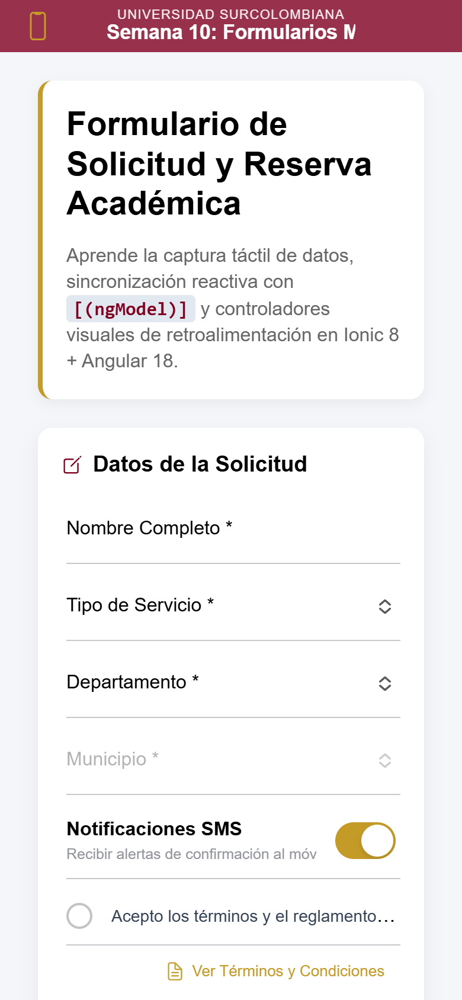
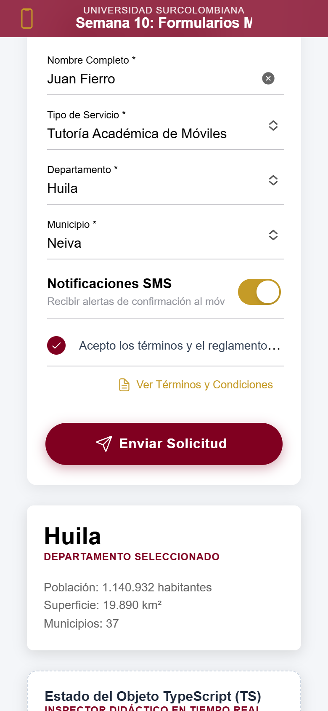
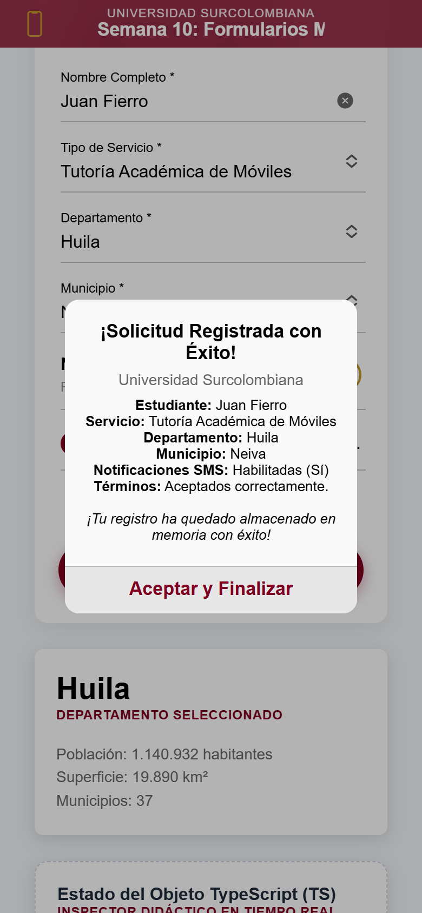

# USCO Reserva Móvil con API Colombia

  

Este repositorio corresponde al tercer parcial (Corte 3, 20 %) de la materia Desarrollo de Dispositivos Móviles, del programa de Ingeniería de Software de la Universidad Surcolombiana (USCO), y consiste en una aplicación hecha con Ionic y Angular que toma como base el formulario de reserva académica del proyecto guía de la materia para extenderlo con datos reales obtenidos desde internet.

Lo que se agrega al proyecto guía es el consumo de [API Colombia](https://api-colombia.com), una API REST pública de solo lectura que no exige API key, de la cual se obtienen los departamentos del país y los municipios de cada uno para que el usuario los elija dentro del mismo formulario, mientras una tarjeta adicional muestra los datos generales del departamento seleccionado. El uso de una API únicamente de lectura fue aprobado por la profesora del curso.

## Proyecto guía

El punto de partida es el proyecto [usco-ionic-forms-lab](https://github.com/DanielaAlarconS/usco-ionic-forms-lab) de la profesora del curso, que implementa el formulario "USCO Reserva Móvil" de la Semana 10 con `ion-input`, `ion-select`, `ion-toggle` e `ion-checkbox` enlazados mediante `[(ngModel)]`, un Toast para avisar cuando faltan datos, un Alert que resume la solicitud enviada, un `ion-modal` con los términos y condiciones del laboratorio y un inspector que muestra en vivo el objeto `formData`, de modo que se puede observar cómo cambia el estado en TypeScript a medida que se diligencia el formulario.

## Capturas

<table>
  <tr>
    <td align="center">
      
      <br>
      Pantalla inicial
    </td>
    <td align="center">
      
      <br>
      Formulario completo con departamento, municipio y card
    </td>
    <td align="center">
      
      <br>
      Alert de confirmación
    </td>
  </tr>
</table>

## Funcionalidades

- Al abrir la página se cargan los 33 departamentos de Colombia desde la API, una sola vez, y se muestran ordenados por nombre en un `ion-select`.
- Al elegir un departamento se piden sus municipios para llenar un segundo `ion-select`, que permanece deshabilitado mientras no haya departamento seleccionado; si se cambia de departamento, el municipio elegido se limpia.
- Una `ion-card` ubicada entre el formulario y el inspector muestra el nombre, la población, la superficie en km² y el número de municipios del departamento elegido, datos que se toman de la lista ya cargada sin hacer otra petición y que se presentan con formato colombiano (por ejemplo, 1.140.932) mediante `toLocaleString('es-CO')`.
- Si una petición falla, aparece un Toast rojo generado con el `FeedbackService` que ya traía el proyecto guía.
- El departamento y el municipio son obligatorios, y si faltan aparece el mismo Toast de campos obligatorios del formulario.
- El Alert de confirmación incluye el departamento y el municipio por su nombre.
- Todo lo que ya hacía el proyecto guía sigue funcionando igual.

## Endpoints de API Colombia

La URL base de todas las peticiones es `https://api-colombia.com/api/v1`.

| Método | Endpoint | Uso |
| --- | --- | --- |
| GET | `/Department` | Devuelve el arreglo de los 33 departamentos, sin orden alfabético, del cual se usan los campos `id`, `name`, `population`, `surface` y `municipalities`. |
| GET | `/Department/{id}/cities` | Devuelve los municipios del departamento indicado (para Huila, con id 18, trae 37), del cual se usan los campos `id`, `name` y `departmentId`. |

Como algunos endpoints de la API limitan el uso a 60 peticiones por minuto por cada IP, los departamentos se cargan una sola vez al abrir la página y los municipios se piden únicamente cuando el usuario cambia de departamento, con lo que se evita repetir consultas cuyo resultado ya se tiene en memoria.

## Conceptos aplicados

Para poder hacer peticiones HTTP se registró `provideHttpClient()` dentro del arreglo `providers` de `bootstrapApplication` en `main.ts`, ya que el proyecto no tiene un archivo `app.config.ts` y la configuración de la aplicación standalone se hace directamente en el arranque. Sobre esa base se creó el servicio `ApiColombiaService`, marcado con `@Injectable({ providedIn: 'root' })` para que exista una única instancia disponible en toda la aplicación, en el cual se inyecta `HttpClient` con la función `inject()` y se definen dos métodos, `getDepartments()` y `getCities()`, que devuelven un `Observable` tipado con las interfaces `Department` y `City`, de manera que el resto del código sabe con exactitud qué campos llegan de la API. El servicio se limita a hacer las peticiones, mientras que ordenar los resultados queda como tarea de la página que los muestra.

La página `HomePage` implementa la interfaz `OnInit`, y es en `ngOnInit()` donde se pide la lista de departamentos y se hace la suscripción con `subscribe({ next, error })`, separando así lo que ocurre cuando llegan los datos de lo que ocurre cuando la petición falla. No hace falta llamar a `unsubscribe`, porque las peticiones de `HttpClient` emiten una sola respuesta y luego se completan por sí solas, sin dejar suscripciones abiertas.

Los dos selects funcionan en cascada gracias a `(ionChange)="onDepartmentChange($event)"` en el select de departamentos, que limpia el municipio anterior, busca el departamento elegido en la lista ya cargada y pide sus municipios; este evento resulta adecuado porque Ionic solo emite `ionChange` cuando el usuario elige una opción y no cuando el código cambia el valor, lo que evita peticiones disparadas por el propio programa. Tanto los departamentos como los municipios se ordenan con `localeCompare`, que respeta las tildes del español y deja, por ejemplo, Atlántico antes de Bogotá. En la plantilla se usa two-way data binding con `[(ngModel)]` para mantener sincronizados los campos con el objeto `formData`, `*ngFor` para generar las opciones de cada select y `*ngIf` para mostrar la card del departamento solo cuando hay uno seleccionado, en la cual las cifras de población y superficie se presentan con `toLocaleString('es-CO')`.

Los errores de red se informan con el método `showToast` del `FeedbackService` del proyecto guía, en color rojo, y la validación existente de `enviarSolicitud()` se amplió para exigir también `departmentId` y `cityId` antes de construir el resumen. Ese resumen se muestra en el Alert de confirmación con el nombre del departamento y del municipio, y como Ionic 8 trae desactivada por defecto la opción `innerHTMLTemplatesEnabled`, con lo cual pinta como texto plano el mensaje del Alert, mientras que el proyecto guía arma ese mensaje con etiquetas `strong` y `br`, se activó `innerHTMLTemplatesEnabled: true` en `provideIonicAngular` para que el resumen se vea con el formato previsto.

## Stack

- Ionic 8 (`@ionic/angular` 8.8)
- Angular 18 (18.2) con componentes standalone
- TypeScript 5.4
- RxJS 7.8
- Ionicons 7
- API Colombia

## Estructura de src/app

```
src/app/
├── app.component.html
├── app.component.ts
├── app.routes.ts
├── home/
│   ├── home.page.html              modificado: selects en cascada y card del departamento
│   ├── home.page.scss
│   └── home.page.ts                modificado: carga de datos y validación
├── models/
│   ├── booking-request.model.ts    modificado: campos departmentId y cityId
│   ├── city.model.ts               nuevo: interfaz City
│   └── department.model.ts         nuevo: interfaz Department
└── services/
    ├── api-colombia.service.ts     nuevo: peticiones a API Colombia
    └── feedback.service.ts
```

Fuera de esta carpeta también se modificó `src/main.ts`, donde se registró `provideHttpClient()` y se activó `innerHTMLTemplatesEnabled`.

## Cómo ejecutarlo

Se requiere Node.js 18.19 o superior, npm y la CLI de Ionic instalada de forma global:

```bash
npm install -g @ionic/cli
```

Pasos para ejecutar la aplicación en modo de desarrollo:

1. Clonar el repositorio:

```bash
git clone https://github.com/JuanFierro15/tercer-parcial-ionic.git
```

2. Entrar a la carpeta del proyecto:

```bash
cd tercer-parcial-ionic
```

3. Instalar las dependencias:

```bash
npm install
```

4. Iniciar el servidor de desarrollo, que abre la aplicación en http://localhost:8100:

```bash
ionic serve
```

Para generar la compilación del proyecto se usa:

```bash
npm run build
```

## Autor

Juan Fierro ([JuanFierro15](https://github.com/JuanFierro15)), estudiante de Ingeniería de Software de la Universidad Surcolombiana, 2026.
